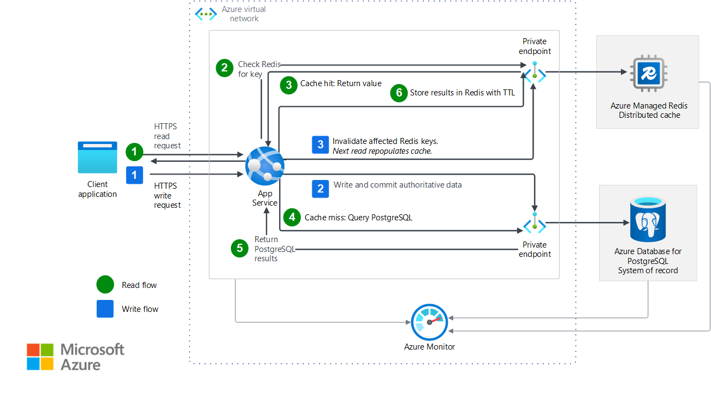
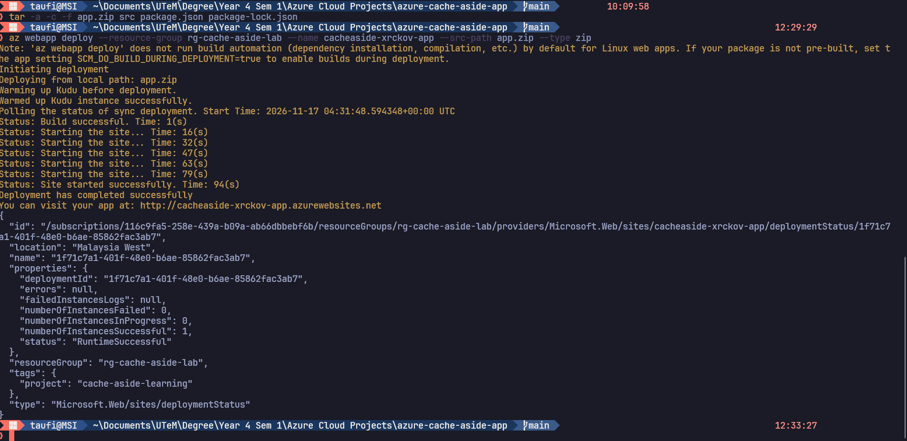
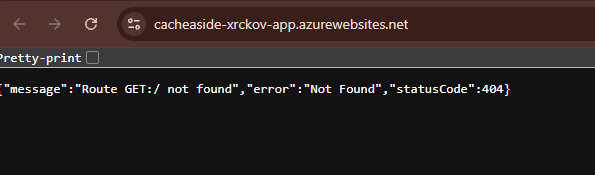
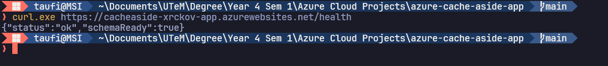
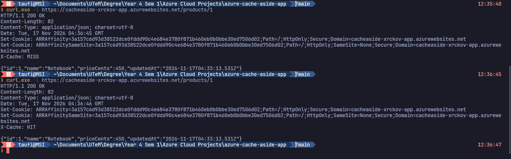
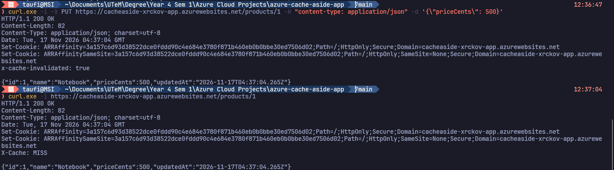
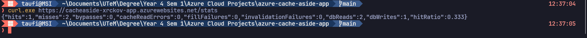
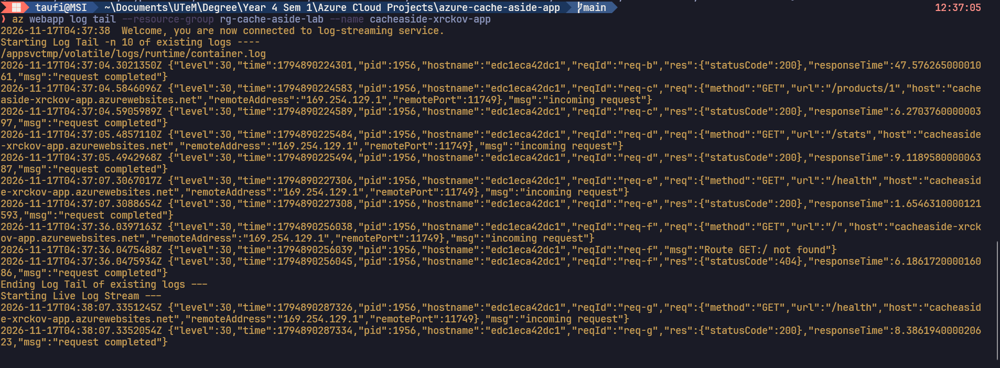
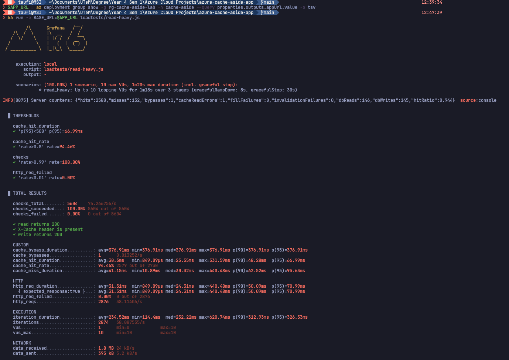
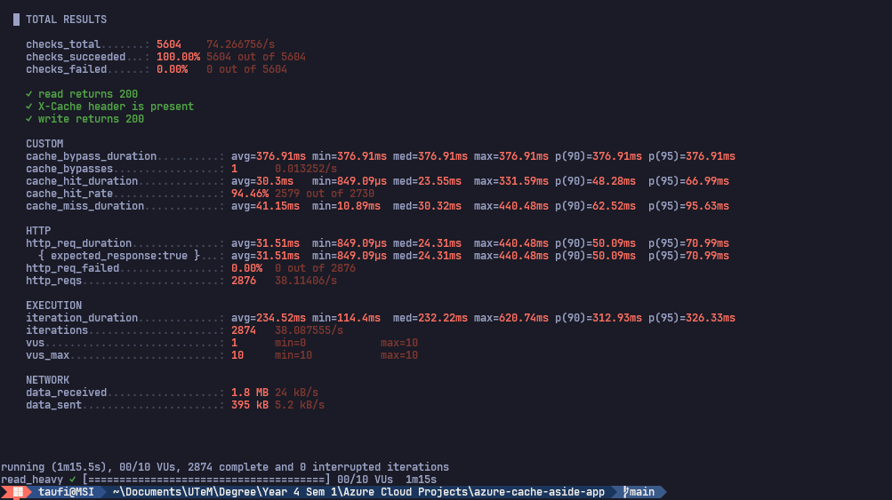

# Cache-aside on Azure: web app

This is a learning project. It is a small Node.js API that implements the cache-aside pattern from the Azure Architecture Center article [Cache-aside caching using Azure Managed Redis and Azure Database for PostgreSQL](https://learn.microsoft.com/en-us/azure/architecture/databases/architecture/cache-aside-azure-managed-redis-postgresql).

> [!NOTE]
> This is a personal learning implementation. It is not official Microsoft guidance.

This repository contains the web app. The Azure infrastructure lives in a separate repository, [cache-aside-infra](https://github.com/tttaufiqqq/azure-cache-aside-infra-architecture). Deploy that repository first.



Diagram adapted from the [Azure Architecture Center](https://learn.microsoft.com/en-us/azure/architecture/databases/architecture/cache-aside-azure-managed-redis-postgresql).

## 1. Learning goals

- Implement the read path and write path of the cache-aside pattern in code.
- Handle cache failures without failing requests.
- Connect to Redis and PostgreSQL with a managed identity and Microsoft Entra ID.
- Observe cache hits and misses with a response header and counters.
- Measure the effect of the cache with a k6 load test.

## 2. Stack

| Layer | Choice |
|---|---|
| Runtime | Node.js 22 |
| Web framework | Fastify |
| Database client | `pg` |
| Cache client | `redis` with `@redis/entraid` |
| Authentication | `@azure/identity` managed identity |
| Load testing | k6 |

The app has no frontend. You test it with `curl`.

## 3. Prerequisites

- The [cache-aside-infra](https://github.com/tttaufiqqq/azure-cache-aside-infra-architecture) deployment is running.
- [Azure CLI](https://learn.microsoft.com/en-us/cli/azure/install-azure-cli), signed in to the same subscription.
- Bash only: `zip` installed on your computer. PowerShell uses the built-in `tar` instead.
- Optional, for load testing: [k6](https://grafana.com/docs/k6/latest/set-up/install-k6/)

> [!NOTE]
> You can't run the app on your computer. Redis and PostgreSQL accept only private traffic, so the app works only inside Azure.

## 4. Quickstart

### 4.1 Bash (Git Bash or WSL)

1. Deploy the app.

   ```bash
   ./scripts/deploy.sh
   ```

1. Request a product twice and compare the `X-Cache` header.

   ```bash
   APP_URL=$(az deployment group show \
     --resource-group rg-cache-aside-lab \
     --name cache-aside \
     --query properties.outputs.appUrl.value -o tsv)

   curl -i "$APP_URL/products/1"
   curl -i "$APP_URL/products/1"
   ```

### 4.2 PowerShell

1. Package and deploy the app.

   ```powershell
   $RG = "rg-cache-aside-lab"
   $APP = az deployment group show -g $RG -n cache-aside --query properties.outputs.appName.value -o tsv
   tar -a -c -f app.zip src package.json package-lock.json
   az webapp deploy --resource-group $RG --name $APP --src-path app.zip --type zip
   ```

1. Request a product twice and compare the `X-Cache` header.

   ```powershell
   $APP_URL = az deployment group show -g $RG -n cache-aside --query properties.outputs.appUrl.value -o tsv
   curl.exe -i "$APP_URL/products/1"
   curl.exe -i "$APP_URL/products/1"
   ```

The first response has `X-Cache: MISS`. The second has `X-Cache: HIT`. For the full walkthrough, see [Deploy and test](docs/deploy.md).

## 5. Endpoints

| Method and path | Description |
|---|---|
| `GET /health` | Returns app status and whether the schema is ready |
| `GET /products` | Lists products from PostgreSQL, uncached |
| `GET /products/:id` | Reads a product with cache-aside and sets `X-Cache` |
| `PUT /products/:id` | Updates a product, then invalidates its cache key |
| `GET /stats` | Returns hit, miss, and failure counters |

## 6. Results

### 6.1 Deployment and health



*Azure CLI output: the web app deployment completed successfully.*



*curl to the root path returns 404 because the app has no root route.*



*The health endpoint reports `schemaReady: true`.*

The `schemaReady: true` response shows that the app reached PostgreSQL through the private endpoint with its managed identity and created its own schema.

### 6.2 Read path: miss, then hit



*Two reads of the same product: first `X-Cache: MISS`, then `X-Cache: HIT`.*

### 6.3 Write path: invalidation



*A PUT returns `x-cache-invalidated: true`, and the next read misses with the new price.*

After the update, the next read misses because the write deleted the cached key. That read refills the cache with the new price.

### 6.4 Counters and logs



*The stats endpoint: 1 hit, 2 misses, 2 database reads, and 1 database write.*



*The live log stream shows structured request logs.*

The counters add up. Two database reads, one write, and one hit match the requests in the screenshots above.

### 6.5 Load test



*k6 summary: cache hit and miss latency, a 94.46% hit rate, and all thresholds passed.*



*k6 totals: 100% of 5,604 checks passed across 2,876 requests.*

The test ran from a laptop in Malaysia against the app in Malaysia West. It used 10 virtual users for 75 seconds, about 95% reads and 5% writes. All four thresholds passed.

| Result | Value |
|---|---|
| Requests | 2,876, about 38 per second |
| Failed requests | 0% |
| Checks passed | 100% of 5,604 |
| Reads | 2,730: 2,579 hits, 150 misses, 1 bypass |
| Cache hit rate | 94.46% |
| Writes | 144, with 0 invalidation failures |

| Latency | Average | Median | p95 |
|---|---|---|---|
| Cache hit | 30.3 ms | 23.6 ms | 67.0 ms |
| Cache miss | 41.2 ms | 30.3 ms | 95.6 ms |

The misses match the design. The 144 writes each deleted a cached key, so the next read of that key missed. That accounts for nearly all of the 150 misses.

For how to run the test and read the results, see [Load testing with k6](docs/load-testing.md).

## 7. Load testing

The `loadtests/read-heavy.js` script sends mostly reads with a few writes and reports latency separately for cache hits and misses.

```bash
k6 run -e BASE_URL=https://<your-app>.azurewebsites.net loadtests/read-heavy.js
```

## 8. Differences from the reference architecture

| Reference architecture | This project | Reason |
|---|---|---|
| Durable invalidation, such as an outbox | Retry twice, then rely on the TTL | Keeps the code small |
| Shared metrics across instances | In-memory counters on each instance | No extra service needed |
| Negative caching for missing rows | Not cached | Keeps the rules simple |
| Application Insights instrumentation | Structured console logs only | Avoids another dependency |

## 9. What I learned

- Cache hits were faster than misses, but not dramatically. The median was 23.6 ms for hits and 30.3 ms for misses. Both include the network round trip from my laptop, and the miss path is only a single-row primary key lookup.
- The hit rate follows the write rate. With 144 writes in the run, about 150 reads missed because each write deletes a key.
- One read bypassed the cache and took 377 ms, but it still returned 200. The fallback to PostgreSQL worked.
- The server counters showed 146 database reads for 153 reads that weren't hits. Seven reads shared a query that was already running, which is the stampede guard at work.
- A committed write must never fail because the cache is down. Invalidation is best effort, and the TTL limits how long a stale value can live.
- Concurrent misses for one key can share a single database query.
- In PowerShell, use `curl.exe` instead of `curl`, and escape the quotes inside JSON bodies.

## 10. Related resources

- [cache-aside-infra](https://github.com/tttaufiqqq/azure-cache-aside-infra-architecture): the infrastructure repository
- [Architecture](docs/architecture.md)
- [Load testing with k6](docs/load-testing.md)
- [Implementation log](docs/implementation-log.md)
- [Troubleshooting](docs/troubleshooting.md)
